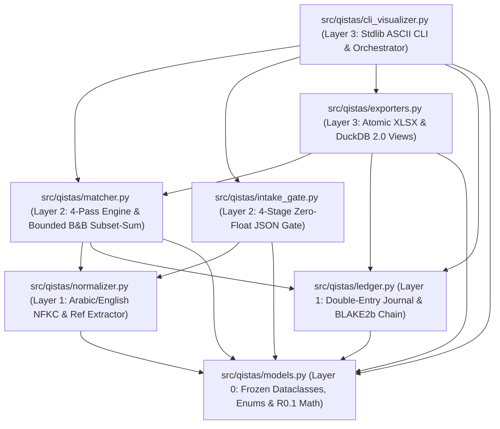

# `Qistas-Core` — Mathematical & Architectural Blueprint (`BLUEPRINT.md`)

**System Identity:** Deterministic Bilingual (Arabic-English) Financial Reconciliation, Double-Entry Ledger & Cryptographic Audit Engine  
**Engineering Canon Grounding:** Codex #01 (TigerStyle Zero-Float & Double-Entry), Codex #02 (NASA JPL Power of 10 Bounded Control Flow), Codex #11 (OSTEP WAL/Hash-Chain & COW Atomic Persistence), Codex #12 (Ousterhout Deep Modules), Codex #14 (DDIA Immutable System-of-Record & Derived Views), and `dimensional-analysis` Fixed-Point Algebra.

---

## § 0. Global Numeric, Temporal & Determinism Contract (`R0.1` – `R0.5`)

### 0.1. Dimensional Vocabulary & Fixed-Point Scaling Algebra

| Dimension Tag | Domain Quantity | Python Representation | Scaling / Conversion Invariant | Valid Domain Bounds |
| :--- | :--- | :--- | :--- | :--- |
| `D2{UoA}` | Monetary minor units (`cents` / `piastres` / `halalas`) | `int` (exact) | Scaled `× 100` from wire string `"DDDD.CC"` | `1 <= amount_cents <= 999_999_999_99` |
| `D3{permille}` | Gateway fee rate (`‰`, parts per `1_000`) | `int` (exact) | `1 permille == 1` part per `1_000` | `0 <= rate_permille <= 1_000` |
| `D0{day}` | Proleptic Gregorian calendar ordinal | `int` (exact) | `datetime.date.fromisoformat(s).toordinal()` | `1 <= day_ordinal <= 3_652_059` |
| `D0{u64}` | Cryptographic audit chain digest | `int` (exact) | 8-byte big-endian unsigned integer | `0 <= chain_hash_u64 < (1 << 64)` |
| `D0{count}` | Cardinality, 0-based index, byte size | `int` (exact) | `count == index + 1` | `0 <= count <= MAX_BOUND` |

### 0.2. Core Architectural Laws (`R0.1` – `R0.5`)

- **`R0.1` (Zero-Float & Zero-Division Operator Law):**
  1. All monetary quantities are stored and manipulated exclusively as 64-bit exact integers (`int`) in minor units (`cents` / `piastres` / `halalas`, dimension `D2{UoA}`).
  2. Fee rates are integer `permille` (`‰`, dimension `D3{permille}`, parts per `1_000`, `0 <= rate_permille <= 1_000`).
  3. ISO-8601 date strings (`"YYYY-MM-DD"`) are converted at the intake boundary to integer proleptic Gregorian ordinals (`day_ordinal: int`, dimension `D0{day}`, via `datetime.date.toordinal()`).
  4. Floating-point types (`float`), `decimal.Decimal`, `fractions.Fraction`, `round()`, `math.floor()`, `math.ceil()`, and the true-division operator are **mechanically banned** across the entire codebase.
  5. Exact integer division is restricted to floor division `n // d` and ceiling division:
     ```python
     def ceil_div(n: int, d: int) -> int:
         assert type(n) is int and type(d) is int
         assert d > 0 and n >= 0
         return -(-n // d)
     ```

- **`R0.2` (Conservative Directional Rounding):**
  Gateway percentage fees round **UP** to the nearest minor unit via ceiling division:
  `pct_fee_cents = ceil_div(gross_cents * rate_permille, 1000) = -(-(gross_cents * rate_permille) // 1000)` (`⌈(gross_cents × rate_permille) ÷ 1000⌉`).
  *Dimensional Proof:* `D2{UoA} * D3{permille} = D5{UoA*permille}`; dividing via `ceil_div(..., 1000)` strips `D3{permille}` and restores `D2{UoA}`.

- **`R0.3` (Double-Entry Conservation of Money — TigerStyle Invariant):**
  Every matched or classified reconciliation event produces an immutable `JournalEntry` across the 5 canonical `AccountCode` accounts (`AR_RECEIVABLE`, `BANK_CASH`, `GATEWAY_FEE_EXPENSE`, `SUSPENSE_CLEARING`, `CUSTOMER_CREDIT_LIABILITY`) satisfying:
  `∑(p.debit_cents for p in postings) == ∑(p.credit_cents for p in postings) > 0`
  Each `LedgerPosting` strictly obeys XOR single-sided positivity:
  `(p.debit_cents > 0 and p.credit_cents == 0) or (p.credit_cents > 0 and p.debit_cents == 0)`

- **`R0.4` (64-Bit BLAKE2b Cryptographic Audit Chain — OSTEP Ch. 42 Integrity):**
  Every `AuditLogEntry` chains `prev_hash_u64` (anchored at `GENESIS_HASH_U64 = 0x5149535441533236`, ASCII `"QISTAS26"`) over all canonical entry fields:
  ```python
  canonical_bytes = (
      f"{seq_no}|{match_kind.value}|{primary_id}|{','.join(secondary_ids)}|"
      f"{gross_cents}|{net_cents}|{fee_cents}|{day_ordinal}|{prev_hash_u64}"
  ).encode("utf-8")
  chain_hash_u64 = int.from_bytes(hashlib.blake2b(canonical_bytes, digest_size=8).digest(), "big")
  ```
  Tampering with any historical entry invalidates `entry[k].prev_hash_u64 == entry[k - 1].chain_hash_u64` for all subsequent entries.

- **`R0.5` (Cross-Platform Total Determinism):**
  Execution is 100% invariant to `PYTHONHASHSEED`, OS, and CPU architecture. Iteration over raw `set` or unordered `dict` keys is forbidden; all candidate lists are explicitly sorted and all ties are broken by smallest `(day_ordinal, id)` or lexicographic ID tuple.

---

## § 1. Domain Rules (`F1` – `F8`) & Edge Cases (`EC-A` – `EC-E`)

### `F1` — Boundary Hygiene & Exact-Type Validation in `__post_init__`
All domain dataclasses (`FeeSchedule`, `Invoice`, `BankTx`, `LedgerPosting`, `JournalEntry`, `ReconciliationMatch`, `UnpaidInvoiceRecord`, `AuditLogEntry`) are `@dataclass(frozen=True, slots=True)` enforcing at construction:
1. **Bool-Masquerade Rejection:** Every integer field `v` must satisfy `type(v) is int` (rejecting `True`/`False`, since `isinstance(True, int)` is `True` in Python).
2. **Identifier Hygiene:** `id` and `ref_code` strings must match `re.compile(r"^[A-Z0-9_-]{1,32}\Z")`.
3. **NUL-Byte Ban:** Every string field `s` must satisfy `type(s) is str and "\x00" not in s`.
4. **Strict Positivity:** `Invoice.amount_cents >= 1`, `BankTx.net_cents >= 1`, and `day_ordinal >= 1`.

### `F2` + `EC-A` — Deterministic Arabic/English Entity & Reference Normalization
Function `normalize_entity(raw: str) -> str` executes a 5-stage deterministic pipeline:
1. **NFKC Compatibility Decomposition:** `s = unicodedata.normalize("NFKC", raw)` — decomposes Arabic Presentation Forms-B ligatures (e.g., Lam-Alef `ﻻ U+FEFB → ل + ا`, `ﻷ U+FEF7 → ل + أ`, `ﻹ U+FEF9 → ل + إ`, `ﻵ U+FEF5 → ل + آ`) and full-width characters.
2. **Combining Mark, Bidi/Format Control & Tatweel Removal:** Keep only codepoints `c` where `unicodedata.category(c) not in ("Mn", "Cf") and c != "\u0640"` (strips Arabic harakat `U+064B..U+065F`, superscript alef `U+0670`, zero-width/Bidi controls `U+200B..U+200F`, `U+202A..U+202E`, `U+2066..U+2069`, `U+FEFF`, and Tatweel `\u0640`).
3. **Arabic/Persian Character & Digit Unification:**
  - Alef family: `أ (\u0623), إ (\u0625), آ (\u0622), ٱ (\u0671) -> ا (\u0627)`
  - Yeh/Maksura family: `ى (\u0649), ئ (\u0626), ی (\u06cc) -> ي (\u064a)`
  - Kaf & Teh Marbuta: `ک (\u06a9) -> ك (\u0643)`, `ة (\u0629) -> ه (\u0647)`, `ؤ (\u0624) -> و (\u0648)`
  - Digits: Eastern Arabic `٠..٩ (\u0660..\u0669)` and Persian `۰..۹ (\u06f0..\u06f9)` → ASCII `0..9`.
4. **Casefold, Punctuation Folding & Safe Legal-Affix Stripping (`EC-A`):**
  - Apply `.casefold()`, replace any non-alphanumeric character (`not in [a-z0-9\u0621-\u064a]`) with `" "`, and split on whitespace into `tokens`.
  - Strip leading/trailing legal entity stop-tokens/phrases (`شركه`, `مؤسسه`, `موسسه`, `مصنع`, `مكتب`, `مجموعه`, `ذ م م`, `ش م م`, `مساهمه`, `محدوده`, `llc`, `ltd`, `inc`, `co`, `corp`, `limited`, `company`, `plc`) **iff** stripping leaves `>= 1` non-empty core token; otherwise retain `tokens` unchanged so an entity composed solely of stop-words is never collapsed to `""`.
5. **Invoice Reference Extractor (`extract_ref_codes(memo: str) -> tuple[str, ...]`):**
  - Apply Stages 1–3 + `.upper()` on `memo`. Extract tokens matching `r"(?<![A-Z0-9])(INV|FAT|REF|BILL|QST)[-_]?([0-9]{2,12}(?:[-_][0-9A-Z]{1,8})?)(?![A-Z0-9])"`, canonicalizing separator to `"-"` (e.g., `"inv_1001"` / `"INV1001"` → `"INV-1001"`, `"FAT-2026-05"` → `"FAT-2026-05"`), deduplicated in first-seen order.

### `F3` — Compound Gateway Fee Equation
Given `FeeSchedule(fixed_fee_cents, rate_permille, min_fee_cents, max_fee_cents, tolerance_cents, max_settlement_lag_days)`:
- `raw_fee = fixed_fee_cents + ceil_div(gross_cents * rate_permille, 1000)`
- `expected_fee = min(max(raw_fee, min_fee_cents), max_fee_cents)` if `max_fee_cents > 0` else `max(raw_fee, min_fee_cents)`
- `actual_fee = gross_cents - net_cents`
A bank deposit `net_cents` matches invoice `gross_cents` iff `0 <= actual_fee <= gross_cents` and:
- **Exact Zero-Fee Match:** `actual_fee == 0` (`fee_error = 0`), OR
- **Gateway Fee Match:** `abs(actual_fee - expected_fee) <= tolerance_cents` (`fee_error = abs(actual_fee - expected_fee)`).

### `F4` + `EC-B` — Settlement Date Window & Weekend Clearing Lag
A bank transaction at `tx.day_ordinal` satisfies the settlement window for an invoice issued at `inv.day_ordinal` iff:
`0 <= tx.day_ordinal - inv.day_ordinal <= max_settlement_lag_days`
Default `max_settlement_lag_days = 5` calendar days absorbs Friday–Saturday (MENA) and Saturday–Sunday (international) weekend clearing delays (`EC-B`) without timezone or holiday-table nondeterminism. For batch matches (`Pass 3`), every invoice `inv` in the subset must individually satisfy `F4` against `tx.day_ordinal`.

### `F5` + `EC-C` + `EC-D` — 4-Pass Deterministic Matching Hierarchy & Bounded Subset-Sum
All input `invoices` and `bank_txs` are pre-sorted by `(day_ordinal, id)`.

- **Pass 1 (Exact Reference Match & `EC-D` Duplicate Payment Alert):**
  For each unmatched `tx` in `(tx.day_ordinal, tx.id)` order, inspect `refs = extract_ref_codes(tx.memo)`:
  1. If any `ref` matches an **open** `inv.id` or `inv.ref_code` satisfying `F4` and `F3`: commit 1-to-1 match (`MatchKind.EXACT_REF` if `actual_fee == 0` else `MatchKind.FEE_ADJUSTED_REF`), marking `inv` and `tx` settled.
  2. **`EC-D` (`DUPLICATE_PAYMENT_ALERT`):** If no open invoice matches, but `ref` matches an **already-settled** invoice `inv_settled` and `F3` holds for `(inv_settled.amount_cents, tx.net_cents)`: classify `tx` as `MatchKind.DUPLICATE_PAYMENT_ALERT` referencing `inv_settled.id` (with `gross_cents = tx.net_cents, fee_cents = 0`) and mark `tx` handled.

- **Pass 2 (1-to-1 Entity + Window + Amount/Fee Match):**
  For each remaining unmatched `tx` with `tx.norm_entity != ""`: filter open invoices with `inv.norm_entity == tx.norm_entity` satisfying `F4` and `F3`. Select the unique candidate minimizing:
  `rank_2(inv) = (fee_error, abs(tx.day_ordinal - inv.day_ordinal), inv.day_ordinal, inv.id)`
  Commit as `MatchKind.ENTITY_EXACT` (`actual_fee == 0`) or `MatchKind.ENTITY_FEE_ADJUSTED` (`actual_fee > 0`).

- **Pass 3 (Bounded Branch-and-Bound Subset-Sum `N-to-1` Batch Payouts — `EC-C`):**
  Constants: `MAX_BATCH_SIZE = 4`, `MAX_EXPANSIONS = 10_000`.
  For each remaining unmatched `tx` with `tx.norm_entity != ""`:
  1. Filter open invoices of `tx.norm_entity` satisfying `F4` and sort **descending** by `amount_cents`, tie-breaking by ascending `(day_ordinal, id)`: `C[0 .. m-1]`.
  2. Precompute suffix sums `suffix_sum[i] = sum(C[j].amount_cents for j in range(i, m))` (`suffix_sum[m] = 0`).
  3. Compute upper feasible gross bound `gross_upper` (maximum gross across `k in {2, 3, 4}` under single-batch fee or sum of per-invoice fees) and lower bound `gross_lower = tx.net_cents`.
  4. Execute an **iterative explicit-stack Branch-and-Bound search** (zero recursion per NASA Rule 1; hard loop ceiling `expansions <= MAX_EXPANSIONS` per NASA Rule 2):
     - **Cardinality Pruning:** Prune if `picked_count > MAX_BATCH_SIZE` or `picked_count + (m - idx) < 2`.
     - **Sorted-Descending Overflow Pruning:** Because `C` is sorted descending, any transition where `running_gross + C[idx].amount_cents > gross_upper` immediately skips `C[idx]`.
     - **Suffix-Sum Underflow Pruning:** If `running_gross + suffix_sum[idx] < gross_lower`, prune the entire subtree immediately in `O(1)`.
  5. A subset `S` (`2 <= len(S) <= 4`) with `gross_cents = sum(inv.amount_cents for inv in S)` is valid if `F3` holds under either **Single Batch Fee** (`expected_gateway_fee(gross_cents, fee)`) or **Per-Invoice Fee Sum** (`sum(expected_gateway_fee(inv.amount_cents, fee) for inv in S)`). Choose the valid subset minimizing:
     `rank_3(S) = (fee_error, len(S), tuple(sorted(inv.id for inv in S)))`
     Commit as `MatchKind.BATCH_SUBSET_SUM` and mark all `inv in S` and `tx` settled.

- **Pass 4 (Partial Payment, Overpayment & Suspense Classification):**
  For each remaining unmatched `tx` in `(tx.day_ordinal, tx.id)` order:
  1. Resolve target open invoice `inv_target`: either via explicit `ref` in `extract_ref_codes(tx.memo)` matching an open invoice (`residual > 0` and `inv.day_ordinal <= tx.day_ordinal`), or a **unique** open invoice for `tx.norm_entity` within `F4`.
  2. **`OVERPAYMENT_CREDIT`:** If `inv_target` exists and `tx.net_cents > residual`: settle `inv_target` (`gross_cents = residual`, `excess_cents = tx.net_cents - residual`, `residual = 0`).
  3. **`EXACT_REF` / `ENTITY_EXACT` Residual Settlement:** If `inv_target` exists and `tx.net_cents == residual`: settle `inv_target` (`gross_cents = residual`, `residual = 0`).
  4. **`PARTIAL_PAYMENT`:** If `inv_target` exists and `0 < tx.net_cents < residual`: classify as `MatchKind.PARTIAL_PAYMENT`, credit `tx.net_cents` against `inv_target`, and decrement `residual -= tx.net_cents`.
  5. **`ORPHAN_BANK_DEPOSIT`:** Otherwise classify `tx` as `MatchKind.ORPHAN_BANK_DEPOSIT` (`SUSPENSE_CLEARING`).
  6. **`UNPAID_INVOICE`:** All invoices remaining open after Pass 4 (`residual > 0`) are emitted in `(day_ordinal, id)` order as `UnpaidInvoiceRecord(invoice_id, residual_cents, day_ordinal, norm_entity)`.

### `F6` — Double-Entry Journal & Trial Balance Generation
Every reconciliation outcome generates a balanced `JournalEntry`:

| `MatchKind` | Debit Postings (`debit_cents > 0`) | Credit Postings (`credit_cents > 0`) | Conservation Equation (`R0.3`) |
| :--- | :--- | :--- | :--- |
| `EXACT_REF` / `ENTITY_EXACT` / `BATCH_SUBSET_SUM` (`fee == 0`) | `BANK_CASH`: `net_cents` | `AR_RECEIVABLE`: `gross_cents` | `net_cents == gross_cents` |
| `FEE_ADJUSTED_REF` / `ENTITY_FEE_ADJUSTED` / `BATCH_SUBSET_SUM` (`fee > 0`) | `BANK_CASH`: `net_cents`<br>`GATEWAY_FEE_EXPENSE`: `actual_fee` | `AR_RECEIVABLE`: `gross_cents` | `net_cents + actual_fee == gross_cents` |
| `PARTIAL_PAYMENT` | `BANK_CASH`: `net_cents` | `AR_RECEIVABLE`: `net_cents` | `net_cents == net_cents` |
| `OVERPAYMENT_CREDIT` | `BANK_CASH`: `net_cents` | `AR_RECEIVABLE`: `gross_cents`<br>`CUSTOMER_CREDIT_LIABILITY`: `net_cents - gross_cents` | `net_cents == gross_cents + excess_cents` |
| `DUPLICATE_PAYMENT_ALERT` (`EC-D`) | `BANK_CASH`: `net_cents` | `CUSTOMER_CREDIT_LIABILITY`: `net_cents` | `net_cents == net_cents` |
| `ORPHAN_BANK_DEPOSIT` | `BANK_CASH`: `net_cents` | `SUSPENSE_CLEARING`: `net_cents` | `net_cents == net_cents` |

### `F7` — 4-Stage Zero-Float JSON Boundary Gate (`qistas.bundle/v1`)
1. **Stage 1 (Byte Ceiling & UTF-8 Hygiene):** Enforce `len(raw_bytes) <= 4_194_304` (`4 MiB`), strict UTF-8 decode, and reject `"\x00"`.
2. **Stage 2 (Iterative Depth-8 Scanner):** Scan characters with an explicit loop tracking quote/escape state and bracket depth (`{`, `[`); abort with `IntakeError` if depth exceeds `MAX_JSON_DEPTH = 8` or brackets mismatch.
3. **Stage 3 (Zero-Float Parse & Envelope Check):** Parse via `json.loads(text, parse_float=str, parse_int=_bounded_int, parse_constant=_reject_const, object_pairs_hook=_no_dup_keys)` and verify `schema_version == "qistas.bundle/v1"`.
4. **Stage 4 (Exact Decimal Scaling & Per-Record `RecordRejection` Isolation):**
   - Monetary wire strings (`"1250.50"`) are parsed via `parse_decimal_to_cents(s: str) -> int` matching `r"^(0|[1-9][0-9]{0,11})(?:\.([0-9]{1,2}))?\Z"`. Malformed amounts, dates, or IDs inside `invoices` or `bank_txs` do **not** abort `ingest_json_bundle_report`; they append an immutable `RecordRejection(record_type, index, record_id, code, detail)` while valid records proceed (duplicate IDs are rejected on second occurrence).

### `F8` + `EC-E` — CWE-1236 Spreadsheet Formula Neutralization & Atomic Export
1. **CWE-1236 Neutralization (`EC-E`):** Function `neutralize_formula_cell(val: str) -> str` checks both `val` and `unicodedata.normalize("NFKC", val).lstrip()`. If either begins with any prefix in `("=", "+", "-", "@", "|", "%", "\t", "\r", "\n")`, prepend `"'"` (`"'" + val`). When writing `.xlsx` via `openpyxl`, every text cell explicitly forces `cell.data_type = "s"`.
2. **Atomic COW Disk Write:** Exports write to `target.with_name(f".tmp_{target.name}.{os.getpid()}")`, `os.fsync()`, close, and atomically commit via `os.replace(tmp_path, target)`.
3. **DuckDB 2.0 Analytical Views:** Populate normalized integer tables (`journal_postings`, `reconciliation_matches`, `unpaid_invoices`) and expose deterministic SQL view `v_trial_balance` using exact `BIGINT` arithmetic via `query_duckdb_summary`.

---

## § 2. Module Topology & Dependency DAG



| Module Path | Layer | Internal Dependencies | Responsibility & Deep-Module Contract |
| :--- | :---: | :--- | :--- |
| `src/qistas/models.py` | `L0` | `None` (stdlib only) | Value-semantic `@dataclass(frozen=True, slots=True)` domain entities, `StrEnum`s, `ceil_div`, `parse_iso_day`, `format_iso_day`, and `F1` invariants. |
| `src/qistas/normalizer.py` | `L1` | `models` | `F2` + `EC-A` 5-stage Arabic/English entity normalization and `extract_ref_codes`. |
| `src/qistas/ledger.py` | `L1` | `models` | `R0.3` double-entry posting builder, `TrialBalance` aggregator, and `R0.4` 64-bit BLAKE2b audit chain verifier. |
| `src/qistas/matcher.py` | `L2` | `models`, `normalizer`, `ledger` | `F3`–`F6` 4-pass reconciliation engine, `EC-C` iterative Branch-and-Bound subset-sum solver, `EC-D` duplicate payment guard. |
| `src/qistas/intake_gate.py` | `L2` | `models`, `normalizer` | `F7` 4-stage `qistas.bundle/v1` boundary gate (`4 MiB` cap, depth-8 scanner, `parse_decimal_to_cents`, `RecordRejection` isolation). |
| `src/qistas/exporters.py` | `L3` | `models`, `ledger`, `matcher` | `F8` + `EC-E` CWE-1236 formula sanitizer, atomic executive `.xlsx` writer (`openpyxl.styles`), and `DuckDB 2.0` analytical SQL summary. |
| `src/qistas/cli_visualizer.py` | `L3` | `models`, `normalizer`, `intake_gate`, `matcher`, `ledger`, `exporters` | Zero-dependency stdlib deterministic ASCII report renderer, `--demo` scenario builder, and CLI entrypoint. |
| `src/qistas/__init__.py` | `API` | All `src/qistas/*` | Public package re-exports (`__all__`) with `PEP 562` lazy loading for `cli_visualizer`. |

---

## § 3. Architectural Fitness Functions & Verification Suite (`tests/`)

| Test Module | Verification Scope & Mechanical AST / Property Invariants |
| :--- | :--- |
| `tests/_oracle.py` | Independent reference oracle (`itertools.combinations`) for fee math, double-entry conservation, subset-sum optimality, and BLAKE2b hash chaining. |
| `tests/test_architecture_fitness.py` | **AST & Oracle Fitness Suite (`FF-1`–`FF-8`):** `FF-1` Zero `ast.Div`/`float`/`Decimal`; `FF-2` Strict import allowlist & banned calls; `FF-3` Zero recursion; `FF-4` Function ceiling `<= 60` LOC; `FF-5` Assertion density `>= 2`/fn; `FF-6` Frozen+slots dataclasses; `FF-7`/`FF-7b` `1,050`-seed oracle differential parity; `FF-8` SVG & docs integrity gate. |
| `tests/test_models_and_normalizer.py` | `F1` boundary rejections (`bool` as `int`, NUL bytes, bad IDs) and `F2`/`EC-A` Arabic ligature (`ﻻ`, `ﻷ`), harakat, Bidi, digit, and stop-word edge cases. |
| `tests/test_matcher_and_ledger.py` | `F3`–`F6`, `EC-B` weekend lag, `EC-C` Branch-and-Bound pruning (`max_expansions = 10_000`), `EC-D` duplicate alert, `R0.3` conservation, and `R0.4` tamper detection. |
| `tests/test_intake_and_exporters.py` | `F7` `4 MiB`/depth-8/`RecordRejection` isolation, `F8`/`EC-E` CWE-1236 formula neutralization, atomic `.tmp_` + `os.replace`, `openpyxl.styles` formatting, and `DuckDB 2.0` summary parity. |
