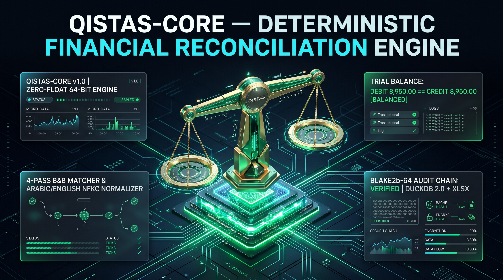
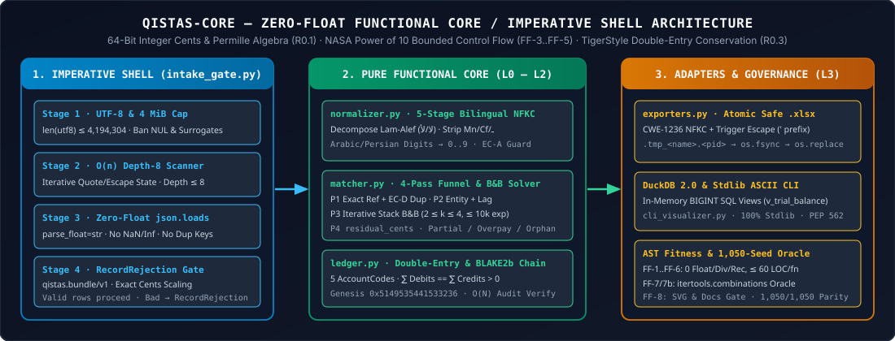
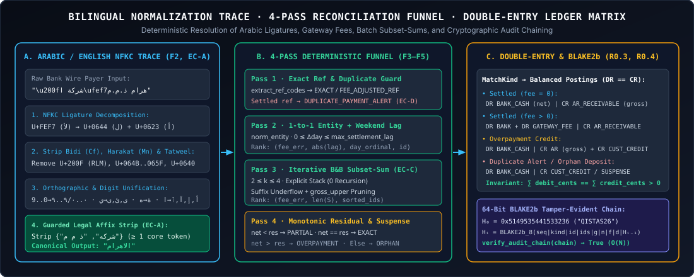

# Qistas-Core (`قِسْطَاس`) — Deterministic Bilingual Financial Reconciliation & Double-Entry Verification Engine

<p align="center">
  
</p>

[](https://www.python.org/)
[](#2-the-6-real-world-financial--security-failure-modes-solved)
[](#3-exact-mathematical--accounting-specification)
[](#5-quantified-verification-loc--benchmark-ledger)
[](LICENSE)

> **Architectural Thesis — AI Capability ≠ AI Authority in Financial Ledgers:**
> Large Language Models and OCR pipelines excel at extracting semi-structured fields from Arabic and English PDF invoices, WhatsApp receipts, and bank statements—an untrusted **AI Capability** tier. They must never hold **Authority** over financial matching, fee arithmetic, or ledger mutation. **Qistas-Core (`قِسْطَاس`)** is the deterministic **Functional Core / Imperative Shell** verification and reconciliation engine that sits downstream of extraction: it quarantines untrusted JSON intake, normalizes Arabic/English entities and memos, executes a bounded 4-pass integer reconciliation funnel, enforces TigerStyle double-entry conservation (`∑ Debits = ∑ Credits`) across a 5-account chart, seals every match into a 64-bit `BLAKE2b` cryptographic hash chain (`GENESIS_HASH_U64 = 0x5149535441533236`), and exports executive `.xlsx` workbooks (`CWE-1236` formula-neutralized with live `=SUM(...)` totals) and `DuckDB 2.0` analytical summaries via atomic crash-safe persistence.

<p align="center">
  
</p>

---

## 1. Why Deterministic Financial Verification Matters

When enterprise payment rails in Egypt and the broader MENA corridor settle commercial invoices across InstaPay, Fawry, Paymob, Kashier, and corporate wire transfers, reconciliation pipelines routinely break on six compounding failure modes:

1. **Corrupted Arabic PDF/OCR Extraction:** PDF copy-paste and OCR emit Unicode Presentation Forms-B (`U+FE70..U+FEFF`, where Lam-Alef ligatures like `ﻻ` `U+FEFB` and `ﻷ` `U+FEF7` decompose under `NFKC` to `U+0644 + U+0627` and `U+0644 + U+0623`), invisible RTL/LTR bidi control marks (`Cf`), harakat (`Mn`), Tatweel (`ـ`), and mixed Eastern/Persian digits (`٠-٩`, `۰-۹`).
2. **Floating-Point Drift & Unmodeled Gateway Deductions:** IEEE-754 `float` representation (`0.1 + 0.2 ≠ 0.3`) and ad-hoc rounding fail when payment processors deduct percentage fees (`rate_permille`), fixed fees (`fixed_fee_cents`), and min/max fee caps (`min_fee_cents`, `max_fee_cents`) within a settlement tolerance (`tolerance_cents`).
3. **Exponential Combinatorial Stalls on Batch Deposits:** When a customer pays `k` open invoices in a single lump-sum bank transfer, naive recursive subset-sum solvers hang on crafted adversarial inputs or pick non-deterministic ties across hash-seed runs.
4. **Unbalanced Single-Entry Spreadsheets:** Traditional reconciliation scripts mark rows as "matched" without maintaining a balanced general ledger for gateway fees, partial payments, overpayments, duplicate settlements, or anonymous orphan deposits.
5. **Brittle Ingestion & DoS Vulnerability:** A single malformed record in a batch crashes the entire pipeline, or deeply nested / multi-megabyte JSON payloads exhaust process memory.
6. **Spreadsheet Formula Injection (`CWE-1236`) & Torn Writes:** Untrusted payer names or bank memos beginning with `=`, `+`, `-`, `@`, `|`, `%`, `\t`, `\r`, or `\n` (or fullwidth `＝` under `NFKC`) execute arbitrary formulas when opened in Excel, while interrupted file exports leave half-written `.xlsx` artifacts on disk.

---

## 2. The 6 Real-World Financial & Security Failure Modes Solved

| Failure ID | Failure Mode & Attack Vector | Qistas-Core Deterministic Engineering Countermeasure |
| :---: | :--- | :--- |
| **`F2` / `EC-A`** | **Arabic Presentation Forms-B (`U+FE70..U+FEFF`), Orthographic Variants & Bidi Spoofing** | Deterministic 5-stage Arabic/English canonicalizer ([`normalizer.py`](src/qistas/normalizer.py)): `NFKC` compatibility decomposition (`ﻻ → ل + ا`, `ﻷ → ل + أ`), stripping of `Mn` harakat, `Cf` bidi format controls, and Tatweel (`\u0640`), Eastern/Persian digit translation (`٠-٩`/`۰-۹ → 0-9`), orthographic unification (`أ/إ/آ/ٱ → ا`, `ة → ه`, `ى/ئ/ی → ي`, `ک → ك`, `ؤ → و`), and guarded legal-affix stripping (`EC-A`). |
| **`R0.1` / `R0.2`** | **IEEE-754 Float Drift & Gateway Fee Rounding Discrepancies** | **Zero-Float / Zero-Decimal Law** (AST-enforced across `src/` and `tests/`). All monetary values are 64-bit integer `cents` (`1 EGP = 100 cents`) and rates are integer `permille` (`25 = 2.5%`). `FeeSchedule(fixed_fee_cents, rate_permille, min_fee_cents, max_fee_cents, tolerance_cents, max_settlement_lag_days)` computes exact integer ceiling division (`ceil_div`) and checks `|(G − B) − Fee(G)| ≤ tolerance_cents`. |
| **`F5` / `EC-C`** | **Combinatorial Explosion & Non-Deterministic Tie-Breaking in Batch Subset-Sum (`Pass 3`)** | NASA Power of 10 **Zero Recursion** (`FF-3`). Explicit iterative Branch-and-Bound solver ([`matcher.py`](src/qistas/matcher.py)) bounded to `MAX_BATCH_SIZE = 4` (`k ∈ {2, 3, 4}`) and `MAX_EXPANSIONS = 10_000`. Evaluates zero-fee, single-batch fee (`Fee(∑ G)`), and per-invoice fee (`∑ Fee(G)`), breaking ties deterministically via total order `(fee_error, len(S), sorted_ids)`. |
| **`R0.3` / `F6` / `R0.4`** | **Silent Value Creation/Destruction, Duplicate Settlements & Post-Facto Ledger Tampering** | **TigerStyle Double-Entry Conservation** ([`ledger.py`](src/qistas/ledger.py)): Every `JournalEntry` across all 9 `MatchKind` outcomes enforces `∑ Debits = ∑ Credits` over 5 accounts (`AR_RECEIVABLE`, `BANK_CASH`, `GATEWAY_FEE_EXPENSE`, `SUSPENSE_CLEARING`, `CUSTOMER_CREDIT_LIABILITY`) and links into a 64-bit `BLAKE2b` (`digest_size=8`) audit chain from `GENESIS_HASH_U64 = 0x5149535441533236` (`"QISTAS26"`). |
| **`F7`** | **Malformed Input Payloads, Float/NaN Injection, Memory Exhaustion & Whole-Batch Crashes** | **4-Stage JSON Boundary Gate** ([`intake_gate.py`](src/qistas/intake_gate.py)): Stage 1 UTF-8 decode, NUL-byte ban & byte cap (`MAX_PAYLOAD_BYTES = 4_194_304` (`4 MiB`)), Stage 2 iterative depth-8 bracket scanner (`MAX_JSON_DEPTH = 8`), Stage 3 zero-float `json.loads` trap (`parse_float=str`, `MAX_INT_DIGITS = 15`, no `NaN`/`Inf`, no duplicate keys), and Stage 4 `qistas.bundle/v1` schema (`MAX_RECORDS = 10_000`) & row-level `RecordRejection` isolation. |
| **`F8` / `EC-E`** | **Excel Formula Injection (`CWE-1236`) & Non-Atomic Torn File Exports** | **Defense-in-Depth Output Hardening** ([`exporters.py`](src/qistas/exporters.py)): `neutralize_formula_cell()` normalizes via `NFKC` and prepends `'` to any string cell starting with `=`, `+`, `-`, `@`, `|`, `%`, `\t`, `\r`, or `\n` (`cell.data_type = "s"`), while `"Matches"` and `"TrialBalance"` summary rows emit controlled live `=SUM(...)` formulas (`cell.data_type = "f"`). Atomic `.tmp_<name>.<pid>` + `os.fsync` + `os.replace`. |

<p align="center">
  
</p>

---

## 3. Exact Mathematical & Accounting Specification

### 3.1 Integer Gateway Fee Algebra (`R0.2`)

For an invoice gross amount `G` (in integer `cents`) and `FeeSchedule(fixed_fee_cents, rate_permille, min_fee_cents, max_fee_cents, tolerance_cents, max_settlement_lag_days)`:

```text
raw_fee(G) = fixed_fee_cents + ⌈ G × rate_permille ÷ 1,000 ⌉
           = fixed_fee_cents + ceil_div(G × rate_permille, 1000)

floored(G) = max(raw_fee(G), min_fee_cents)
Fee(G)     = min(floored(G), max_fee_cents)   if max_fee_cents > 0 else floored(G)
fee_err    = |(G − B) − Fee(G)| ≤ tolerance_cents
```

For a batch of `k ∈ {2, 3, 4}` (`MAX_BATCH_SIZE = 4`) open invoices `{i₁, …, iₖ}` settled in a single bank transaction (`Pass 3`), [`solve_subset_sum_batch()`](src/qistas/matcher.py) evaluates all three settlement fee structures within `tolerance_cents`:
- **Zero Fee Settlement:** `actual_fee = G_batch − B = 0`.
- **Single Batch Settlement Fee:** `|actual_fee − Fee(G_batch)| ≤ tolerance_cents`.
- **Per-Invoice Aggregated Fee:** `|actual_fee − ∑ Fee(G(iⱼ))| ≤ tolerance_cents`.

### 3.2 Complete 9-Outcome Double-Entry Conservation Matrix (`R0.3`)

Every bank transaction produces a `ReconciliationMatch` and a balanced `JournalEntry` (`∑ Debits = ∑ Credits`) across the 5-account chart of accounts:

| `MatchKind` | Pass | Trigger Condition (`B = tx.net_cents`, `R = residual_cents(inv)`) | `BANK_CASH` (DR) | `GATEWAY_FEE_EXPENSE` (DR) | `AR_RECEIVABLE` (CR) | `CUSTOMER_CREDIT_LIABILITY` (CR) | `SUSPENSE_CLEARING` (CR) |
| :--- | :---: | :--- | :---: | :---: | :---: | :---: | :---: |
| **`EXACT_REF`** | `1` | Memo ref matches open `inv` ∧ `B = R` | `B` | `0` | `R` | `0` | `0` |
| **`FEE_ADJUSTED_REF`** | `1` | Memo ref matches open `inv` ∧ `|(R − B) − Fee(R)| ≤ tol` | `B` | `R − B` | `R` | `0` | `0` |
| **`DUPLICATE_PAYMENT_ALERT`** | `1` | Memo ref matches already-settled `inv` (`R = 0`) | `B` | `0` | `0` | `B` | `0` |
| **`ENTITY_EXACT`** | `2` | Best open `inv` for `norm_entity` in `[0, max_settlement_lag_days]` ∧ `B = R` | `B` | `0` | `R` | `0` | `0` |
| **`ENTITY_FEE_ADJUSTED`** | `2` | Best open `inv` for `norm_entity` in `[0, max_settlement_lag_days]` ∧ `|(R − B) − Fee(R)| ≤ tol` | `B` | `R − B` | `R` | `0` | `0` |
| **`BATCH_SUBSET_SUM`** | `3` | Optimal subset `S` (`2 ≤ \|S\| ≤ 4`) matching `B` under `(fee_err, len(S), sorted_ids)` | `B` | `R_sum − B` | `R_sum` | `0` | `0` |
| **`PARTIAL_PAYMENT`** | `4a` | Memo ref or unique open entity match ∧ `0 < B < R` (outside fee window) | `B` | `0` | `B` | `0` | `0` |
| **`OVERPAYMENT_CREDIT`** | `4b` | Memo ref or unique open entity match ∧ `B > R > 0` | `B` | `0` | `R` | `B − R` | `0` |
| **`ORPHAN_BANK_DEPOSIT`** | `4c` | Unmatched deposit (`0` or `> 1` open entity invoices without memo ref) | `B` | `0` | `0` | `0` | `B` |

---

## 4. Live Walkthrough — Egyptian / MENA Bilingual Corridor Demo

Run the built-in deterministic 8-invoice / 8-transaction corridor fixture (`build_demo_scenario()`) exercising Presentation Forms-B Arabic (`\ufef7`), Eastern Arabic numerals (`١٠٠١`), gateway fee deductions (`3.00 EGP + 2.5% = 53.00 EGP`), 3-invoice subset-sum batching, duplicate payment quarantine, partial/overpayments, and orphan suspense routing:

```text
python -m qistas.cli_visualizer --demo
```

```text
====================================================================================================================
QISTAS-CORE DETERMINISTIC RECONCILIATION REPORT
====================================================================================================================
[MATCHES]
TX ID      | MATCH KIND               | INVOICES                   |           GROSS |           FEE |             NET
--------------------------------------------------------------------------------------------------------------------
TX-2001    | EXACT_REF                | INV-1001                   |    1,000.00 EGP |      0.00 EGP |    1,000.00 EGP
TX-2002    | FEE_ADJUSTED_REF         | INV-1002                   |    2,000.00 EGP |     53.00 EGP |    1,947.00 EGP
TX-2003    | ENTITY_EXACT             | INV-1003                   |    1,500.00 EGP |      0.00 EGP |    1,500.00 EGP
TX-2004    | BATCH_SUBSET_SUM         | INV-1004,INV-1005,INV-1006 |    1,800.00 EGP |      0.00 EGP |    1,800.00 EGP
TX-2005    | DUPLICATE_PAYMENT_ALERT  | INV-1001                   |    1,000.00 EGP |      0.00 EGP |    1,000.00 EGP
TX-2006    | PARTIAL_PAYMENT          | INV-1007                   |      750.00 EGP |      0.00 EGP |      750.00 EGP
TX-2007    | OVERPAYMENT_CREDIT       | INV-1008                   |      500.00 EGP |      0.00 EGP |      650.00 EGP
TX-2008    | ORPHAN_BANK_DEPOSIT      | -                          |        0.00 EGP |      0.00 EGP |      250.00 EGP

[DOUBLE-ENTRY TRIAL BALANCE]
ACCOUNT CODE                 |              DEBIT |             CREDIT
----------------------------------------------------------------------
AR_RECEIVABLE                |           0.00 EGP |       7,550.00 EGP
BANK_CASH                    |       8,897.00 EGP |           0.00 EGP
GATEWAY_FEE_EXPENSE          |          53.00 EGP |           0.00 EGP
SUSPENSE_CLEARING            |           0.00 EGP |         250.00 EGP
CUSTOMER_CREDIT_LIABILITY    |           0.00 EGP |       1,150.00 EGP
----------------------------------------------------------------------
TOTAL (BALANCED)             |       8,950.00 EGP |       8,950.00 EGP

[UNPAID INVOICE RESIDUALS]
INVOICE ID   | NORMALIZED ENTITY              |           RESIDUAL
------------------------------------------------------------------
INV-1007     | giza trading                   |         450.00 EGP

[AUDIT CHAIN & SOLVER SUMMARY]
BLAKE2b-64 Audit Chain : PASS (8 entries)
Chain Tail Hash (u64)  : 0xed6d7db28a045fbe
Subset-Sum Expansions  : 5 (proven_optimal=True)
====================================================================================================================
```

---

## 5. Quantified Verification, LOC & Benchmark Ledger

### 5.1 Architectural Fitness Suite (`FF-1` to `FF-8`) & Brute-Force Oracle Parity

Every commit is verified by **110 automated tests** (`pytest -v`), **0 lint findings** (`ruff check src/ tests/`), and **0 type errors** (`ty check src/`):

| Fitness ID | Mechanical Verification Gate (`tests/test_architecture_fitness.py`) | Scope & Measured Result |
| :---: | :--- | :--- |
| **`FF-1`** | **Zero-Float & Zero-Division AST Gate (`test_ff1_zero_float_and_division_ast`)** | Scans every AST node across `src/qistas/*.py` and `tests/*.py`: `0` `ast.Div` (`/`), `0` `float`/`complex` literals, `0` `float()`/`Decimal()`/`round()` calls, `0` banned numeric imports. |
| **`FF-2`** | **Import Allowlist & Banned Calls AST Gate (`test_ff2_import_allowlist_and_banned_calls_ast`)** | Enforces strict per-module `_ALLOWLISTS` DAG (`0` Layer 3 imports in `L0–L2`, `0` 3rd-party imports in `cli_visualizer.py`) and bans `eval`, `exec`, `compile`, `open`, `__import__`, `input`. |
| **`FF-3`** | **NASA Rule 1 Zero-Recursion Call-Graph Gate (`test_ff3_zero_recursion_ast`)** | Builds the full static intra-module call graph across `src/qistas/*.py` and runs iterative 3-color DFS cycle detection: `0` cycles. |
| **`FF-4`** | **TigerStyle Function Length Ceiling Gate (`test_ff4_function_length_ceiling_ast`)** | Verifies every `FunctionDef` across `src/qistas/*.py` satisfies `end_lineno - lineno + 1 <= 60` (`100%` compliance). |
| **`FF-5`** | **TigerStyle Assertion Density Gate (`test_ff5_assertion_density_ast`)** | Verifies every `FunctionDef` across `src/qistas/*.py` contains `>= 2` runtime `assert` statements (`100%` compliance). |
| **`FF-6`** | **Immutable Slotted Dataclasses Gate (`test_ff6_immutable_slot_dataclasses_ast`)** | Verifies all `11` domain dataclasses across `src/qistas/*.py` declare `@dataclass(slots=True, frozen=True)` (`100%` compliance). |
| **`FF-7` / `7b`** | **Brute-Force Oracle Differential Fuzzers (`test_ff7_*` & `test_ff7b_*` — `1,050 Seeds`)** | [`tests/_oracle.py`](tests/_oracle.py) (`itertools.combinations` reference oracle) matches [`reconcile()`](src/qistas/matcher.py) across `50 + 1,000 = 1,050` deterministic seeds with coverage floors across all `MatchKind`s. |
| **`FF-8`** | **SVG XML, Asset, LOC & Documentation Integrity Gate (`test_ff8_svg_and_docs_integrity`)** | Parses `assets/*.svg` (`0` unused markers, `<= 46` chars per panel text), verifies all `` assets, zero LaTeX math delimiters in all 4 `.md` specs, `pyproject.toml` metadata, and exact `src/qistas/*.py` LOC parity. |

### 5.2 Repository Module Inventory & Line-of-Code (LOC) Budget

| Layer | File Path | LOC | Primary Responsibility |
| :---: | :--- | :---: | :--- |
| **Layer 0** | [`src/qistas/models.py`](src/qistas/models.py) | `226` | Frozen domain dataclasses/enums, `ceil_div`, `parse_iso_day`, `format_iso_day` |
| **Layer 1** | [`src/qistas/normalizer.py`](src/qistas/normalizer.py) | `93` | 5-stage Arabic/English `NFKC` canonicalizer, Presentation Forms-B & `extract_ref_codes` |
| **Layer 1** | [`src/qistas/ledger.py`](src/qistas/ledger.py) | `261` | 5-account double-entry posting engine, `expected_gateway_fee` & `BLAKE2b` chain |
| **Layer 2** | [`src/qistas/matcher.py`](src/qistas/matcher.py) | `403` | 4-pass reconciliation funnel & iterative Branch-and-Bound subset-sum solver |
| **Layer 2** | [`src/qistas/intake_gate.py`](src/qistas/intake_gate.py) | `392` | 4-stage JSON boundary gate, float/NaN trap & row-level `RecordRejection` isolation |
| **Layer 3** | [`src/qistas/exporters.py`](src/qistas/exporters.py) | `283` | Executive 4-sheet `.xlsx` exporter (`openpyxl.styles`, `CWE-1236`) & `DuckDB 2.0` SQL |
| **Layer 3** | [`src/qistas/cli_visualizer.py`](src/qistas/cli_visualizer.py) | `270` | Zero-dependency deterministic ASCII report renderer & `--demo` CLI entrypoint |
| **Facade** | [`src/qistas/__init__.py`](src/qistas/__init__.py) | `120` | Public API re-exports & `PEP 562` lazy loading for `cli_visualizer` |
| **Tests** | [`tests/`](tests/) (`5` test & oracle modules) | `1,593` | Unit, property, security, AST fitness (`FF-1..FF-8`), and 1,050-seed oracle suite |
| **Specs** | [`BLUEPRINT.md`](BLUEPRINT.md), [`SPEC.md`](SPEC.md), [`ADR.md`](ADR.md), [`HANDOFF.md`](HANDOFF.md) | `726` | Mathematical blueprint, normative contracts, 5 ADRs, and symbol registry |

---

## 6. Quickstart CLI, Python API & `DuckDB 2.0` / `.xlsx` Usage

### 6.1 Installation & Verification

```text
pip install -e .
pytest -v
ruff check src/ tests/
ty check src/
```

### 6.2 CLI Usage (`--demo`, `--bundle`, `--export-xlsx`, `--currency`)

```text
python -m qistas.cli_visualizer --demo --export-xlsx qistas_demo_report.xlsx
python -m qistas.cli_visualizer --bundle bundle.json --export-xlsx out/report.xlsx --currency EGP
```

### 6.3 Programmatic Python API

```python
from pathlib import Path
from qistas import (
    build_demo_scenario,
    export_xlsx_atomic,
    ingest_json_bundle,
    ingest_json_bundle_report,
    query_duckdb_summary,
    reconcile,
    render_reconciliation_report,
    verify_audit_chain,
)

# 1. Run built-in bilingual corridor scenario (or ingest untrusted JSON via ingest_json_bundle)
invoices, bank_txs, fee = build_demo_scenario()
result = reconcile(invoices, bank_txs, fee)

# 2. Verify cryptographic audit chain & double-entry trial balance conservation
assert verify_audit_chain(result.audit_chain) is True
assert result.trial_balance.total_debit_cents == result.trial_balance.total_credit_cents

# 3. Export atomic Big-4 styled XLSX workbook & query in-memory DuckDB 2.0 analytical summary
export_xlsx_atomic(result, Path("qistas_demo_report.xlsx"))
summary = query_duckdb_summary(result)
print(render_reconciliation_report(result, currency="EGP"))
```

---

## 7. License

Released under the [MIT License](LICENSE). Copyright (c) 2026 Qistas Systems Engineering.
